# Zero ERP — Database Blueprint

> **Purpose:** This is the canonical logical database blueprint for Zero ERP. It defines the target relational model, table responsibilities, relationships, tenant boundaries, integrity rules, transaction boundaries, access-control model, and database verification requirements. Database migrations and deployed PostgreSQL objects must implement this contract.

## Blueprint at a glance

- **Platform:** PostgreSQL through Supabase.
- **Tenant model:** One organization owns each business record; users access organizations through membership.
- **Core business model:** 27 physical tables total—24 business tables plus three RBAC tables—across organization setup, accounting, master data, inventory, purchasing, sales, expenses, and payments.
- **Access-control model:** Three RBAC tables—`roles`, `permissions`, and `role_permissions`—plus `organization_users.role_id`.
- **Ledger model:** Journal headers and debit/credit lines are separate; posted financial activity is corrected through controlled reversals.
- **Inventory model:** Immutable movement history is the audit trail; `inventory_balances` is the current stock/valuation snapshot.
- **Security model:** Deny-by-default authorization, organization-scoped foreign-key integrity, explicit RPC grants, and Row-Level Security (RLS).

This document is the design contract for database implementation and review. It does not claim that every constraint, function, index, or RLS policy described here is already deployed.

## 1. Logical entity-relationship diagram

The diagram shows the primary relationships between core entities. Relationship labels represent logical cardinality; the detailed relationship tables below define the required tenant-scoped constraints.

```mermaid
erDiagram
  ORGANIZATIONS ||--o{ ORGANIZATION_USERS : has
  ORGANIZATIONS ||--o{ ROLES : defines
  ROLES ||--o{ ORGANIZATION_USERS : assigned_to
  ROLES ||--o{ ROLE_PERMISSIONS : grants
  PERMISSIONS ||--o{ ROLE_PERMISSIONS : included_in
  ORGANIZATIONS ||--o{ ACCOUNTING_PERIODS : owns
  ORGANIZATIONS ||--o{ ACCOUNTS : owns
  ACCOUNTS o|--o{ ACCOUNTS : parent_of
  ACCOUNTING_PERIODS ||--o{ JOURNAL_ENTRIES : contains
  JOURNAL_ENTRIES ||--|{ ACCOUNT_TRANSACTIONS : has_lines
  ACCOUNTS ||--o{ ACCOUNT_TRANSACTIONS : posted_to
  ORGANIZATIONS ||--o{ CONTACTS : owns
  ORGANIZATIONS ||--o{ PRODUCTS : owns
  UNITS_OF_MEASURE ||--o{ PRODUCTS : measures
  ORGANIZATIONS ||--o{ UNITS_OF_MEASURE : defines
  ORGANIZATIONS ||--o{ INVENTORY_BALANCES : snapshots
  PRODUCTS ||--o{ INVENTORY_BALANCES : has_balance
  PRODUCTS ||--o{ INVENTORY_TRANSACTIONS : moves
  ORGANIZATIONS ||--o{ PURCHASE : owns
  PURCHASE ||--|{ PURCHASE_ITEMS : contains
  PURCHASE ||--o{ PURCHASE_RETURNS : may_have_returns
  PURCHASE_RETURNS ||--|{ PURCHASE_RETURN_ITEMS : contains
  ORGANIZATIONS ||--o{ SALES : owns
  SALES ||--|{ SALES_ITEMS : contains
  SALES ||--o{ SALES_RETURNS : may_have_returns
  SALES_RETURNS ||--|{ SALES_RETURN_ITEMS : contains
  ORGANIZATIONS ||--o{ EXPENSES : owns
  EXPENSE_CATEGORIES ||--o{ EXPENSES : classifies
  ORGANIZATIONS ||--o{ PAYMENTS : owns
  PAYMENTS ||--o{ PAYMENT_ALLOCATIONS : allocates
  ORGANIZATIONS ||--o{ NUMBER_SEQUENCES : numbers
```



The diagram is a logical overview, not executable DDL. Use the relationship matrix and schema inventory in this document when defining exact foreign keys, composite tenant keys, optionality, and uniqueness.

## 2. Database design standards

### 2.1 Primary keys and tenant ownership

1. Every table has a stable primary key named `id`; use the existing project convention for its SQL type consistently.
2. Every organization-owned table carries `organization_id`, directly or through a parent relation where explicitly justified. Direct ownership columns are preferred for tenant-scoped query performance and policy clarity.
3. Use composite uniqueness such as `UNIQUE (organization_id, id)` on tenant-owned parent records where needed to support composite foreign keys.
4. For every reference between organization-owned records, enforce both record identity and organization equality at the database layer. An FK to `id` alone does not prevent cross-organization references.
5. Use `NOT NULL` for required business attributes and foreign keys; use nullable columns only where the workflow explicitly permits absence.
6. Store timestamps consistently as timezone-aware timestamps, monetary values as fixed-precision `numeric` rather than floating-point, and calendar-only business dates as `date`.
7. Define explicit `CHECK` constraints for non-negative amounts, valid quantity/sign conventions, allowed numeric ranges, and valid date ranges where applicable.
8. Use unique constraints for organization-scoped business identifiers and document numbers. Do not rely on a pre-insert application query to prevent duplicates.

### 2.2 Naming and lifecycle conventions

- Use lowercase `snake_case` for schemas, tables, columns, indexes, constraints, and functions.
- Name foreign-key constraints with a predictable pattern such as `<table>_<column>_fkey`; name indexes to reflect table and indexed columns.
- Keep created/updated timestamps consistent. Update `updated_at` through a trusted database trigger or a single consistent server-side write path.
- Keep posted accounting and inventory movement history auditable. Do not hard-delete posted financial records or movement history.
- Use explicit status values and documented state transitions. Reject unknown states at the database boundary.
- Store document numbers as business identifiers, not as primary keys.
- Treat polymorphic references as a deliberate exception; validate target type, existence, and tenant ownership in a trusted database workflow.

### 2.3 Data ownership classes

| Class | Tables | Required boundary |
| --- | --- | --- |
| Tenant roots and membership | `organizations`, `organization_users` | Membership is organization-specific; organization creation and initial administrator assignment are atomic |
| Tenant configuration | `accounting_periods`, `accounts`, `number_sequences`, `units_of_measure`, `expense_categories` | Every record belongs to one organization |
| Global access catalog | `permissions` | System-managed catalog; no tenant client writes |
| Tenant access configuration | `roles`, `role_permissions` | Role and membership must belong to the same organization |
| Master data | `contacts`, `products` | All linked records must share organization ownership |
| Financial ledger | `journal_entries`, `account_transactions` | Balanced, period-valid, immutable after posting except controlled reversal |
| Inventory | `inventory_transactions`, `inventory_balances` | Movement history and balance snapshot updated atomically |
| Commercial documents | `purchase`, `purchase_items`, `purchase_returns`, `purchase_return_items`, `sales`, `sales_items`, `sales_returns`, `sales_return_items` | Header, lines, counterparties, products, accounts, and posting entries must share the same organization |
| Cash and expenses | `expenses`, `payments`, `payment_allocations` | Validate account ownership, allocation targets, and posting effects |

## 3. Schema dependency and implementation order

Create or migrate database objects in dependency order so foreign keys and policy helpers can be established without circular deployment failures.

1. **Platform prerequisites:** confirm the Supabase Auth user relation and the project's UUID/key conventions.
2. **Tenant foundation:** `organizations`, then `organization_users`.
3. **RBAC catalog:** `permissions`, `roles`, `role_permissions`; add and validate `organization_users.role_id`.
4. **Organization setup:** `accounting_periods`, `accounts`, `units_of_measure`, `number_sequences`.
5. **Master data:** `contacts`, `products`, `expense_categories`.
6. **Ledger foundation:** `journal_entries`, `account_transactions`; then add valid document-to-journal references.
7. **Inventory:** `inventory_transactions`, `inventory_balances`.
8. **Purchasing:** `purchase`, `purchase_items`, `purchase_returns`, `purchase_return_items`.
9. **Sales:** `sales`, `sales_items`, `sales_returns`, `sales_return_items`.
10. **Expenses and payments:** `expenses`, `payments`, `payment_allocations`.
11. **Integrity and performance:** composite tenant foreign keys, unique/check constraints, indexes, triggers, and validation queries.
12. **Authorization:** helper functions, RLS policies, explicit function grants, and cross-tenant regression tests.
13. **Transactional operations:** posting, reversal, allocation, period closure, and number allocation RPCs.
14. **Release validation:** apply to a clean test database, migrate representative existing data, run integrity/security tests, and verify rollback procedures before production deployment.

Where references form a dependency cycle—for example, business documents pointing to journal entries while journal entries reference source documents—create the base tables first and add the later foreign keys in a subsequent migration.

## 4. Canonical table inventory

The data model contains 24 business tables plus three RBAC tables (27 tables total). The complete column reference later in this document is the canonical inventory of documented fields. Use the bootstrap SQL to confirm SQL types, defaults, nullability, and constraints.

| Domain | Tables | Main responsibility |
| --- | --- | --- |
| Organization | `organizations`, `organization_users` | Tenant identity and user membership |
| RBAC | `roles`, `permissions`, `role_permissions` | Role definitions and granular permission assignment |
| Accounting setup | `accounting_periods`, `accounts`, `number_sequences` | Period control, chart of accounts, document numbering |
| Master data | `contacts`, `products`, `units_of_measure`, `expense_categories` | Shared business entities and classification |
| General ledger | `journal_entries`, `account_transactions` | Journal headers and debit/credit lines |
| Inventory | `inventory_transactions`, `inventory_balances` | Auditable stock movements and current balance |
| Purchasing | `purchase`, `purchase_items`, `purchase_returns`, `purchase_return_items` | Supplier invoices and purchase returns |
| Sales | `sales`, `sales_items`, `sales_returns`, `sales_return_items` | Customer invoices and sales returns |
| Expense and payment | `expenses`, `payments`, `payment_allocations` | Expenses, settlements, and document allocations |


## 5. System model

Zero ERP is a multi-organization ERP. An authenticated person can be a member of one or more organizations. Every business operation must be scoped to the active organization, and every referenced business record must belong to that same organization.

Core domains:

1. **Tenant and membership:** `organizations`, `organization_users`
2. **Access control:** `roles`, `permissions`, `role_permissions`
3. **Accounting setup:** `accounting_periods`, `accounts`, `number_sequences`
4. **Master data:** `contacts`, `products`, `units_of_measure`, `expense_categories`
5. **Accounting ledger:** `journal_entries`, `account_transactions`
6. **Inventory:** `inventory_transactions`, `inventory_balances`
7. **Purchasing:** `purchase`, `purchase_items`, `purchase_returns`, `purchase_return_items`
8. **Sales:** `sales`, `sales_items`, `sales_returns`, `sales_return_items`
9. **Expenses and cash/bank activity:** `expenses`, `payments`, `payment_allocations`

The core business schema contains 24 tables. The complete Zero ERP data model consists of those tables plus `roles`, `permissions`, and `role_permissions`, with `organization_users.role_id` linking each membership to its role.

## 6. Relationship map

The following relationship map is the canonical relational contract. Foreign keys and tenant boundaries must be enforced in PostgreSQL, not only in application code.

### Tenant and access control

| Parent | Child / linking column | Cardinality | Notes |
| --- | --- | --- | --- |
| `organizations.id` | `organization_users.organization_id` | 1:N | Organization membership records |
| Auth user ID | `organization_users.user_id` | User-to-membership 1:N | The exact auth schema/provider FK must be verified |
| `organizations.id` | `roles.organization_id` | 1:N | Each organization's roles are isolated |
| `roles.id` | `organization_users.role_id` | 1:N | One role per membership in this design |
| `roles.id` | `role_permissions.role_id` | 1:N | Role-to-permission join rows |
| `permissions.id` | `role_permissions.permission_id` | 1:N | Global system permission catalog |
| `roles` ↔ `permissions` | `role_permissions` | M:N | Unique pair `(role_id, permission_id)` |

### Accounting setup and ledger

| Parent | Child / linking column | Cardinality | Notes |
| --- | --- | --- | --- |
| `organizations.id` | `accounting_periods.organization_id` | 1:N | Periods belong to one organization |
| `organizations.id` | `accounts.organization_id` | 1:N | Chart of accounts per organization |
| `accounts.id` | `accounts.parent_account_id` | Self-referencing 1:N | Account hierarchy; parent and child must share organization |
| `accounting_periods.id` | `journal_entries.accounting_period_id` | 1:N | Entry must fall within the period's dates |
| `journal_entries.id` | `account_transactions.journal_entry_id` | 1:N | Journal header and its debit/credit lines |
| `accounts.id` | `account_transactions.account_id` | 1:N | Each line posts to an account |
| `contacts.id` | `account_transactions.contact_id` | 1:N, optional | Contact dimension on a ledger line |
| `journal_entries.id` | `journal_entries.reversal_of_id` | Self-reference, optional | Reversal entry points to original entry |
| `journal_entries.id` | Business documents' `posted_journal_entry_id` | 1:0..N references | Purchases, sales, returns, expenses, and payments can reference posting entries; decide if one-to-one uniqueness is required |
| `organizations.id` | `number_sequences.organization_id` | 1:N | Sequence per organization and document type |

### Master data and inventory

| Parent | Child / linking column | Cardinality | Notes |
| --- | --- | --- | --- |
| `organizations.id` | `units_of_measure.organization_id` | 1:N | Organization-specific units |
| `organizations.id` | `products.organization_id` | 1:N | Product catalog |
| `units_of_measure.id` | `products.unit_id` | 1:N | Product base unit |
| `accounts.id` | `products.inventory_account_id`, `sales_account_id`, `cogs_account_id` | 1:N per role | Ledger mapping; all accounts must belong to the product's organization |
| `organizations.id` | `contacts.organization_id` | 1:N | Customers, suppliers, and counterparties |
| `organizations.id` | `inventory_balances.organization_id` | 1:N | Organization-scoped stock snapshot |
| `products.id` | `inventory_balances.product_id` | 1:N logically; usually one current balance per product | Enforce unique `(organization_id, product_id)` so each organization has one current balance row per product |
| `products.id` | `inventory_transactions.product_id` | 1:N | Inventory movement history |
| `contacts.id` | Purchase/sales/return/payment/expense counterparty columns | 1:N | Supplier/customer/contact references; validate exact FK columns |
| `expense_categories.id` | `expenses.expense_category_id` | 1:N | Expense classification |
| `accounts.id` | `expense_categories.expense_account_id` | 1:N | Expense category ledger mapping |

### Purchases and purchase returns

| Parent | Child / linking column | Cardinality | Notes |
| --- | --- | --- | --- |
| `purchase.id` | `purchase_items.purchase_id` | 1:N | Invoice header and lines |
| `purchase.id` | `purchase_returns.purchase_id` | 1:N | Returns against a purchase invoice |
| `purchase_returns.id` | `purchase_return_items.purchase_return_id` | 1:N | Return header and lines |
| `purchase_items.id` | `purchase_return_items.purchase_item_id` | 1:N | Links a return line to its original purchase line |
| `products.id` | `purchase_items.product_id`, `purchase_return_items.product_id` | 1:N | Purchased/returned product |
| `contacts.id` | `purchase.supplier_id`, `purchase_returns.supplier_id` | 1:N | Must resolve to a supplier/contact in the same organization |
| `accounts.id` | `purchase.payable_account_id`, `purchase_returns.payable_account_id` | 1:N | Accounts payable mapping |
| `journal_entries.id` | `purchase.posted_journal_entry_id`, `purchase_returns.posted_journal_entry_id` | 1:0..1 required | Posting reference |

### Sales and sales returns

| Parent | Child / linking column | Cardinality | Notes |
| --- | --- | --- | --- |
| `sales.id` | `sales_items.sales_id` | 1:N | Sales invoice header and lines |
| `sales.id` | `sales_returns.sales_id` | 1:N | Returns against a sales invoice |
| `sales_returns.id` | `sales_return_items.sales_return_id` | 1:N | Return header and lines |
| `sales_items.id` | `sales_return_items.sales_item_id` | 1:N | Links a return line to its original sales line |
| `products.id` | `sales_items.product_id`, `sales_return_items.product_id` | 1:N | Sold/returned product |
| `contacts.id` | `sales.customer_id`, `sales_returns.customer_id` | 1:N | Must resolve to a customer/contact in the same organization |
| `accounts.id` | `sales.receivable_account_id`, `sales_returns.receivable_account_id` | 1:N | Accounts receivable mapping |
| `journal_entries.id` | `sales.posted_journal_entry_id`, `sales_returns.posted_journal_entry_id` | 1:0..1 required | Posting reference |

### Expenses and payments

| Parent | Child / linking column | Cardinality | Notes |
| --- | --- | --- | --- |
| `expense_categories.id` | `expenses.expense_category_id` | 1:N | Category for each expense |
| `contacts.id` | `expenses.contact_id`, `payments.contact_id` | 1:N, optional | Counterparty/contact |
| `accounts.id` | `expenses.payable_account_id` | 1:N, optional | Payable/settlement account mapping |
| `accounts.id` | `payments.account_id`, `payments.settlement_account_id` | 1:N | Payment source and settlement accounts |
| `payments.id` | `payment_allocations.payment_id` | 1:N | One payment can be split across documents |
| `journal_entries.id` | `expenses.posted_journal_entry_id`, `payments.posted_journal_entry_id` | 1:0..1 required | Ledger posting reference |

**Polymorphic references:** `payment_allocations.document_type/document_id`, `journal_entries.reference_type/reference_id`, and `inventory_transactions.reference_type/reference_id` are polymorphic patterns. A normal SQL foreign key cannot validate `document_id` against several possible tables. Validate document type, record existence, and matching organization in a trusted database function/trigger or application service, or replace the polymorphic reference with explicit nullable FKs where appropriate.

## 7. Production data-integrity constraints

The database must enforce the following integrity rules using foreign keys, unique constraints, check constraints, indexes, triggers, and transactional functions where appropriate.

### Tenant integrity
- All organization-owned records must have a valid `organization_id`.
- Every FK from one organization-owned record to another must remain within the same organization. A plain FK on `id` alone does not prove tenant equality. Use composite unique keys such as `UNIQUE (organization_id, id)` and composite foreign keys for tenant-scoped references.
- Enforce organization-scoped uniqueness for business identifiers, e.g. account code, product code, contact number, document number, and sequence type.
- Add appropriate indexes for `organization_id`, FK columns, date filters, status filters, and frequent lookup paths.

### Ledger integrity
- `debit >= 0` and `credit >= 0`; a line must not have both debit and credit positive.
- A posted journal entry must balance: sum(debit) = sum(credit), within the chosen currency precision.
- Use a controlled posting function/transaction to prevent a header becoming posted before its lines and related document/inventory effects are committed.
- Prevent duplicate posting, and use a reversal entry rather than editing posted ledger lines.
- Prevent posting into closed accounting periods unless an explicit, authorized exception is recorded.

### Inventory integrity
- Use positive quantities for movement magnitude and store direction separately, or define and enforce one consistent sign convention.
- Prevent accidental duplicate inventory movements for the same source document/line.
- Reconcile inventory movement history with `inventory_balances`; update both atomically.
- Decide and document costing method, rounding, negative-stock policy, return costing, and treatment of non-inventory products.

### Documents and allocations
- Validate line quantities, prices, totals, discounts, and amounts on the server/database—not only in the UI.
- Ensure return quantities do not exceed eligible original quantities, accounting for previous returns.
- Ensure payment allocations are non-negative and their sum does not exceed the available/unallocated payment amount, unless over-allocation is an explicit feature.
- Define allowed status transitions and make posting/reversal idempotent.

## 8. Required RPC contracts

These RPC contracts define the database operations exposed to the application. Each function must be implemented in PostgreSQL, secured with explicit grants, and tested before the corresponding application workflow is enabled. Call a function through `supabase.rpc(...)` using its implemented signature.

| RPC contract | Purpose | Required guarantees |
| --- | --- | --- |
| `create_organization_with_admin(p_name, ...)` | Create organization, protected Administrator role, role-permission links, and creator membership | Single transaction; derive creator from `auth.uid()`; never accept arbitrary creator user ID from an untrusted client |
| `assign_member_role(p_membership_id, p_role_id)` | Assign a role to an organization membership | Caller must be authorized Administrator; role and membership must belong to the same organization |
| `create_custom_role(p_organization_id, p_name, p_status)` | Create organization-scoped custom role | Verify caller membership and role-management permission; enforce unique organization/name |
| `set_role_permissions(p_role_id, p_permission_ids)` | Replace/update permissions on a custom role | Validate each permission against global catalog; block unsafe modification of protected Administrator role |
| `confirm_transaction_document(p_organization_id, p_document_type, p_document_id)` | Confirm a supported draft transaction document | Enforce per-type permission, tenant scope, draft-only transition, and basic document/line validation; no ledger or inventory impact |
| `revert_transaction_document_to_draft(p_organization_id, p_document_type, p_document_id)` | Unlock a confirmed document for correction | Confirmed-only transition; clear confirmation metadata; no ledger or inventory impact |
| `void_transaction_document(p_organization_id, p_document_type, p_document_id, p_reason)` | Cancel an unposted document | Draft/confirmed only; require a reason; retain audit metadata; never void posted documents |
| `delete_draft_transaction_document(p_organization_id, p_document_type, p_document_id)` | Hard-delete a draft and its draft-only child rows | Draft-only; permission checked; posted/confirmed/void records cannot be deleted |
| `post_journal_entry(p_entry_id)` | Validate and post a journal entry | Balance debits/credits; check period, organization, permissions, idempotency; commit status and posting atomically |
| `post_opening_balances(p_organization_id, p_accounting_period_id, p_entry_date, p_account_lines, p_party_balances, p_inventory_lines, p_description)` | One-time organization opening balance initialization using existing tables only | Derive customer receivables and supplier payables from contact-tagged control-account lines; derive inventory value from product opening quantities/costs; balance the journal; lock the organization/period; initialize stock; reject duplicate opening posts; commit all effects atomically |
| `post_contact_payment(p_organization_id, p_payment_id, p_accounting_period_id)` | Post a customer receipt or supplier payment against the existing contact-wise control-account balance | Receipt: debit cash/bank and credit receivables; supplier payment: debit payables and credit cash/bank; validate current outstanding, contact, control account, period and permission; reject overpayment and duplicate posting; update the payment and ledger atomically |
| `post_sales(p_organization_id, p_sales_id)` | Post a sales invoice to customer receivables, revenue, COGS and inventory | Debit the receivable asset control account with the customer contact; credit product revenue accounts; calculate COGS from locked weighted-average stock cost; reduce inventory and write stock movements atomically |
| `reverse_journal_entry(p_entry_id, p_date, p_reason)` | Create controlled reversal | Require authorization; preserve original entry; validate target period; prevent repeated reversal |
| `post_purchase(p_purchase_id)` | Post purchase and associated inventory/accounting effects | Validate supplier, lines, accounts, period, and tenant; atomically create ledger/inventory effects |
| `post_sales(p_sales_id)` | Post sale and associated inventory/accounting effects | Validate customer, stock policy, lines, accounts, and tenant; atomically create ledger/inventory effects |
| `post_purchase_return(p_return_id)` | Post purchase return | Validate source purchase/line quantities and tenant; atomically update stock and ledger |
| `post_sales_return(p_return_id)` | Post sales return | Validate source sale/line quantities and tenant; atomically update stock and ledger |
| `record_payment_and_allocate(p_payment, p_allocations)` | Record payment and allocate it to documents | Validate allocation totals and document ownership; atomically post accounting effects |
| `close_accounting_period(p_period_id)` | Close a period | Require permission; validate unresolved/posting rules; record who/when closed |
| `next_document_number(p_organization_id, p_document_type)` | Allocate the next document number | Use row locking or an atomic sequence operation to avoid duplicates under concurrency |

### RPC security rules
1. For user-facing operations, derive the actor from `auth.uid()` and resolve active membership server-side; do not trust a client-provided user ID.
2. Validate the caller's permission and active organization inside the function. Do not rely on a UI check.
3. Use `SECURITY INVOKER` by default. If `SECURITY DEFINER` is necessary, set a safe `search_path`, fully qualify object names, revoke default execution from `PUBLIC`, and grant execute only to intended roles.
4. Grant `EXECUTE` explicitly to intended Supabase roles (commonly `authenticated` for user operations). Do not expose privileged maintenance functions to `anon`.
5. Make financial posting functions transactional and idempotent; use row locks or unique idempotency keys where concurrent requests could duplicate effects.
6. Avoid accepting arbitrary `organization_id` as authority. If it is an input, prove the caller is an active member with the required permission in that organization.
7. Test unauthorized callers, cross-tenant IDs, duplicate calls, concurrent calls, and rollback behavior.

## 9. Required Row-Level Security (RLS) policies

The policies below define the required access-control behavior for Supabase-exposed tables. Enable RLS on every tenant-owned table and verify the resulting policies in PostgreSQL as part of deployment and regression testing.

### Baseline approach

- Enable RLS on every organization-owned table exposed through the Supabase Data API.
- For ordinary business tables, authorize access only when the request user has an active `organization_users` membership for the row's `organization_id`.
- For writes, also validate the requested action's permission and ensure referenced rows belong to the same organization.
- Use both `USING` and `WITH CHECK` where appropriate. `USING` controls which existing rows can be read/updated/deleted; `WITH CHECK` validates inserted or updated row values.
- Deny by default. Do not add broad `TO authenticated USING (true)` policies to tenant data.
- RLS does not replace constraints or business validation. The Supabase service role bypasses RLS, so its key must never reach browser/client code.
- Avoid policy recursion: if membership/permission checks query RLS-protected membership tables, use a carefully secured helper function or a narrowly scoped design that does not recursively invoke the same policies.

### Policy matrix

| Table/group | SELECT | INSERT | UPDATE | DELETE |
| --- | --- | --- | --- | --- |
| `organizations` | Active member of that organization | Through trusted organization-creation RPC | Active member with organization-settings permission | Normally blocked; use controlled archival/deactivation |
| `organization_users` | Self membership and/or authorized organization Administrator | Trusted invite/join/admin flow only | Authorized Administrator; protect last Administrator and role assignment rules | Controlled removal flow; protect last Administrator |
| `roles` | Active organization member with role-read permission | Authorized Administrator/role manager; no client-created system role | Authorized role manager; protect system Administrator | Block system role deletion; custom role only if safe and unassigned |
| `permissions` | Authenticated users only if the global catalog is intended to be visible | No client writes; system migration/maintainer only | No client writes; system migration/maintainer only | No client writes |
| `role_permissions` | Active organization member with role-read permission, scoped through role's organization | Authorized role manager; validate role organization | Usually replace rows via a controlled RPC | Authorized role manager; never remove required admin access |
| All accounting/master/transaction tables | Active membership in row's organization plus read permission | Create permission and same-tenant checks | Update permission; posted financial records require controlled workflow | Deny for posted/financial history; use void/reversal/archival workflows |
| `payment_allocations` | Membership in allocation's organization | Authorized payment workflow; validate payment and target document tenant | Controlled payment workflow | Controlled unallocation only if accounting rules allow |
| Polymorphic references | Read through parent row's organization | Validate `document_type`, target existence, and organization in trusted code/RPC | Controlled workflow | Controlled workflow |

Implement each matrix row as explicit PostgreSQL policies and secure helper functions using the project's actual auth and membership columns. Keep the policy predicates consistent across parent tables, child tables, and join tables.

### Membership predicate pattern

Membership authorization must verify that `auth.uid()` has an active membership in the row's organization. Use the actual membership status column and protect helper functions with explicit grants.

```sql
exists (
  select 1
  from public.organization_users ou
  where ou.organization_id = <row>.organization_id
    and ou.user_id = auth.uid()
    and ou.is_active = true
)
```

Replace `<row>` with the relevant policy table alias when creating a table-specific policy. Validate recursion, grants, and query plans.

### Required RLS verification

Run these checks in a trusted SQL console against the target database before declaring RLS complete:

```sql
-- Tables and whether RLS is enabled/forced
select n.nspname as schema_name,
       c.relname as table_name,
       c.relrowsecurity as rls_enabled,
       c.relforcerowsecurity as rls_forced
from pg_class c
join pg_namespace n on n.oid = c.relnamespace
where c.relkind = 'r'
  and n.nspname = 'public'
order by c.relname;

-- Actual policies
select schemaname, tablename, policyname, permissive,
       roles, cmd, qual, with_check
from pg_policies
where schemaname = 'public'
order by tablename, policyname;

-- User-defined functions potentially exposed as RPCs
select n.nspname as schema_name,
       p.proname as function_name,
       pg_get_function_identity_arguments(p.oid) as arguments,
       p.prosecdef as security_definer,
       p.proconfig as function_settings
from pg_proc p
join pg_namespace n on n.oid = p.pronamespace
where n.nspname = 'public'
  and p.prokind = 'f'
order by p.proname;
```

Also inspect function execute grants and table grants; a function's existence alone does not mean it is safely exposed or callable from Supabase RPC.

## 10. RBAC workflow

### Organization creation
1. Authenticated creator requests organization creation.
2. Trusted server/RPC derives the creator using `auth.uid()`.
3. In one transaction, create the organization.
4. Create the organization's protected system role named `Administrator` (`is_system_role = true`; status active).
5. Link the system-defined permission set to that role.
6. Insert the creator's active `organization_users` membership with that role's `role_id`.
7. Commit only if all steps succeed; otherwise roll back the entire operation.

### Role and permission management
- Permission definitions are maintained by system migrations/developers, not created by ordinary organization Administrators.
- An Administrator creates custom organization-scoped roles and selects permissions from the global catalog.
- Protect the system Administrator role from deletion/deactivation and ensure a tenant cannot be left with no active Administrator.
- Check that a role and membership share the same organization on every assignment.
- This contract assigns one role per organization membership. A future multi-role model must use a dedicated membership-role junction table and a coordinated migration.

## 11. Financial and inventory transaction lifecycle

Lifecycle contract implemented in the bootstrap schema:

1. **Draft:** editable through a trusted write path; no accounting or inventory impact. Draft documents may be hard-deleted through `delete_draft_transaction_document`.
2. **Confirmed:** validation passed and the document is locked against direct edits. Confirmation records `confirmed_at` and `confirmed_by`; it creates no ledger or inventory effects. A confirmed document can be reverted to Draft through `revert_transaction_document_to_draft`, then edited or deleted.
3. **Posted:** only a Confirmed source document may be posted by a posting RPC. Posting records `posted_by` and the posting reference where applicable. Ledger and inventory writes must be atomic and duplicate posting must be rejected.
4. **Void:** Draft or Confirmed documents can be cancelled with a required reason; `voided_at`, `voided_by`, and `void_reason` preserve the audit trail. Void documents cannot be edited, posted, or hard-deleted.
5. **Posted corrections:** never edit or hard-delete posted financial records. Use a controlled reversal or a valid return document and retain the original record.
6. **Generated journals:** journal entries created internally by a source document's posting RPC are posted in the same atomic transaction; they do not need a separate user confirmation step.

The bootstrap defines `confirm_transaction_document`, `revert_transaction_document_to_draft`, `void_transaction_document`, and `delete_draft_transaction_document`. These functions enforce organization membership, explicit lifecycle permissions, status guards, and audit fields. Table writes remain revoked from browser roles so the lifecycle cannot be bypassed by direct client updates.

**Posting coverage limitation:** the current bootstrap has posting implementations for purchases, sales, payments/receipts, manual journal entries, and opening balances. Dedicated `post_expense`, `post_purchase_return`, and `post_sales_return` RPCs are not yet implemented; those document types must not be treated as production-ready for posting until their accounting/inventory rules and functions are implemented and tested.

### Opening balance initialization (existing tables only)

The opening balance workflow intentionally introduces no staging or sub-ledger tables. The application submits three JSON arrays to `post_opening_balances`: ordinary GL account lines, customer/supplier summary balances (one amount per contact, not invoice-wise), and product opening stock lines. The RPC validates and posts directly into `journal_entries`, `account_transactions`, `inventory_transactions`, and `inventory_balances`. Customer and supplier balances are distinguished by the supplied party type because `contacts` does not currently store a customer/supplier discriminator. Corrections after the one-time post must use a reversal or adjustment; the opening entry itself is not edited. Sales invoices use `post_sales`; the invoice's `receivable_account_id` must be the same active, postable Receivable asset control account used by opening customer balances and subsequent receipts. The RPC tags the receivable debit with the invoice's `customer_id`, so the contact-wise outstanding query includes both opening balances and posted sales. It also credits product revenue accounts, calculates COGS from the locked weighted-average stock cost, reduces inventory, and writes inventory movement history atomically. Subsequent receipts and supplier payments use `post_contact_payment`; the payment's `account_id` is the cash/bank account and `settlement_account_id` is the relevant receivable/payable control account. Purchase posting must use an active, postable payable **control** liability account (not an arbitrary liability account), so supplier invoices and later payments share the same contact-wise control-account ledger. The RPC uses the same `contact_id` and control account to calculate and reduce outstanding balances, without invoice-wise allocation. It rejects payments greater than the current outstanding amount. Transfers and refunds are outside this RPC.

`account_transactions.contact_id` is the party ledger dimension. Customer opening receivables debit the receivable asset control account; supplier opening payables credit the payable liability control account. Later receipts/payments must post against the same contact and control account to maintain the outstanding balance. Invoice-wise opening allocation and aging are deliberately out of scope.

## 12. Test plan

### Tenant isolation
- User in organization A cannot read, update, delete, or infer rows in organization B.
- User cannot assign an organization B role to an organization A membership.
- Referenced account/product/contact/document IDs from another organization are rejected.
- Inactive membership loses access immediately.

### RBAC
- Organization creator receives Administrator automatically.
- An ordinary member cannot create roles or change role permissions.
- A custom role only grants its selected permissions.
- System Administrator role cannot be deleted/deactivated or stripped of essential access by normal role-management flows.
- At least one authorized Administrator remains after member removal/role changes.

### Accounting
- Unbalanced journals cannot post.
- Opening balances reject unbalanced totals, duplicate organization-level opening posts, cross-tenant contacts/products/accounts, invalid party control account types, and non-zero pre-existing stock for products being initialized.
- Opening customer/supplier balances appear in contact-wise ledger queries through `account_transactions.contact_id`; receipts/payments reduce the same party balance when posted to the same control account. Posted sales invoices debit the same customer receivable control account with `contact_id = sales.customer_id`, and the customer receipt RPC reduces that balance.
- Opening inventory movements reconcile to `inventory_balances` and the inventory asset control-account debit.
- Posting to a closed period is rejected.
- Concurrent/double posting does not duplicate ledger or inventory effects.
- Posted entries are corrected through reversals, not silent mutation.
- Return quantities and payment allocations cannot exceed valid source balances.

### RLS and RPC
- Test as `anon`, authenticated users with different memberships, and trusted server/service role separately.
- Verify RLS on every exposed table, including child tables and join tables.
- Verify RPC grants, `SECURITY DEFINER` settings if used, cross-tenant rejection, idempotency, and rollback on failure.
- Run the RLS/RPC inventory queries in Section 5 and record results in a verified implementation checklist.

## 13. Production release acceptance checklist

- [ ] Actual migrations and DDL match the documented columns and constraints.
- [ ] Every intended FK, unique constraint, check constraint, and index exists.
- [ ] All public/API-exposed tenant tables have RLS enabled and tested.
- [ ] The real policy inventory is recorded; policy matrix above has been implemented or differences documented.
- [ ] The real RPC/function inventory, signatures, execute grants, and security modes are recorded.
- [ ] Organization creation and Administrator assignment are atomic.
- [ ] Journal posting, reversal, inventory updates, returns, and payment allocation are transactional and tested.
- [ ] Cross-organization negative tests pass.
- [ ] No service-role secret is exposed to client-side code.

## 14. Production governance

Treat `supabase/initial_database_schema.sql` and this architecture contract as a single versioned unit. The SQL file is the canonical bootstrap for a new, empty Supabase PostgreSQL database; run it once through the Supabase SQL Editor after Supabase Auth is available. It is not an incremental upgrade script and must not be run against a database that already contains these objects. Future schema changes must update this canonical file, then be validated from a clean database and regression-tested before release. The live PostgreSQL catalog remains the operational source of truth; deployment checks must detect drift from this contract.
